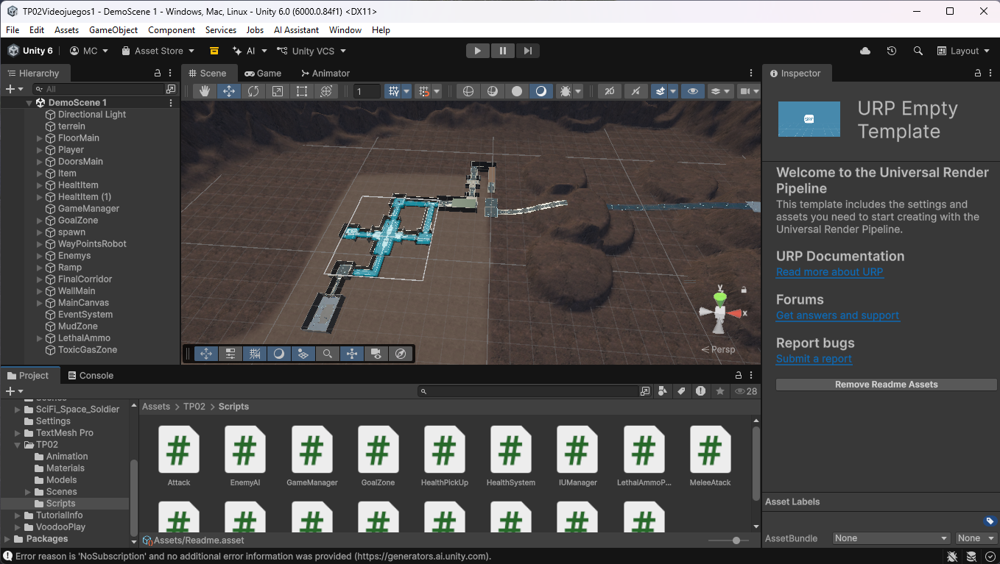
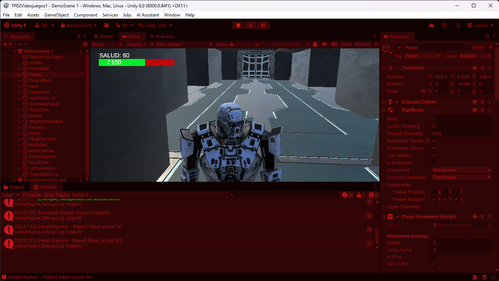

# TP2: Prototipo de Infiltración - Base Espacial Abandonada

* **Asignatura:** Programación de Videojuegos 1 (PVJ1)
* **Estudio Simulado:** CubeGame Studios (Proyecto: *Metal Gear Solid: Ghost Infiltration*)
* **Estudiante:** Mailen Anaid Castro
* **Libreta Universitaria (LU):** TUV000582
* **Motor de Desarrollo:** Unity 6 LTS (Lenguaje C#)

---

##  Descripción del Proyecto

El prototipo sitúa al jugador en una **base espacial militar abandonada** controlada por robots centinelas descontrolados. El objetivo principal consiste en infiltrarse por el terreno, recuperar un dispositivo con información confidencial (`Item`) y transportarlo a salvo hasta la zona de extracción/carga (`GoalZone`).

A lo largo del nivel, el jugador deberá sortear peligros ambientales como zonas de barro que reducen la velocidad y áreas de gas tóxico que dañan la salud, mientras evade o neutraliza a los robots enemigos patrulleros haciendo uso de su arma por Raycast y potenciadores de munición letal.

---

##  Controles del Juego

| Acción | Tecla / Control | Descripción |
| :--- | :--- | :--- |
| **Moverse** | `W` `A` `S` `D` | Desplazamiento continuo en 8 direcciones. |
| **Saltar** | `Espacio` | Salto validado por detección de suelo mediante `Physics.Raycast`. |
| **Disparar** | `Clic Izquierdo` | Disparo instantáneo por Raycast que aturde o destruye enemigos. |
| **Interactuar** | `E` | Interacción frontal a distancia (filtrada con `LayerMask`) y recolección. |
| **Pausar** | `Escape` (`Esc`) | Pausa el juego y congela la simulación (`Time.timeScale = 0`). |
| **Reanudar** | `R` | Reanuda el juego restaurando la escala de tiempo a 1. |

---

## Mecánicas Principales Obligatorias

1. **Detección e Interacción por Raycast + LayerMask:**
   - **Ground Check:** Validación de suelo mediante un `Physics.Raycast` vertical descendente para permitir el salto únicamente si el personaje se encuentra sobre una superficie transitable.
   - **Interacción Selectiva:** Detección frontal de objetos y terminales mediante Raycast filtrado con máscaras de capa (`LayerMask`), garantizando que la tecla `E` solo interactúe con elementos válidos.

2. **Navegación e IA con NavMesh:**
   - Escenario horneado con malla de navegación (`NavMesh`) adaptada a los desniveles del terreno.
   - Robots enemigos equipados con `NavMeshAgent` que ejecutan ciclos de patrulla entre puntos de control y persiguen automáticamente al jugador al ingresar en su radio de detección. Si alcanzan al jugador, le aplican daño físico continuo.

3. **Sistema de Salud, Daño y Puntuación:**
   - Registro centralizado de vida (`PlayerHealth`). Al recibir daño de los enemigos o del entorno, la salud disminuye. Existen botiquines médicos distribuidos por el mapa que restauran puntos de vida al contacto.
   - Sistema de puntuación que otorga **100 puntos** al depositar el `Item` en la `GoalZone` y suma puntos adicionales al neutralizar o destruir robots enemigos.

4. **GameManager y Control de Estados:**
   - Arquitectura centralizada (`GameManager`) que administra los estados de juego: *Inicio*, *Jugando*, *Pausa*, *Victoria* y *Derrota*.
   - Control de pausa mediante congelamiento de la escala temporal (`Time.timeScale`) y registro de métricas y cambios de estado por consola.

5. **Diseño de Escenario con Terrain Tool:**
   - Nivel modelado utilizando las herramientas de terreno de Unity, incorporando desniveles, texturas metálicas/rocosas y caminos diseñados para la infiltración.

---

## Opcionales Implementados (Criterio Destacado)

Se implementaron 3 mecánicas opcionales para enriquecer la experiencia de juego:

1. **Arma por Raycast Aturdidora + Mejora Letal (`PlayerShooting.cs` / `LethalAmmoPickup.cs`):**
   - El jugador cuenta desde el inicio con un arma que dispara por Raycast instantáneo. Por defecto, impactar a un robot enemigo lo aturde, deteniendo temporalmente su `NavMeshAgent` durante unos segundos.
   - Al recoger el potenciador `LethalAmmoPickup`, el arma se sobrecarga temporalmente: los disparos pasan a destruir a los enemigos inmediatamente, sumando puntos al marcador.

2. **Zona de Desaceleración / Barro (`MudZone.cs`):**
   - Área delimitada con colisionadores `Trigger` que detecta la entrada del jugador (`OnTriggerEnter`), reduciendo su velocidad de traslación para simular terreno pesado o fango. Al abandonar la zona (`OnTriggerExit`), la velocidad del jugador se restablece inmediatamente a su valor original.

3. **Zona de Gas Tóxico (`ToxicGasZone.cs`):**
   - Peligro ambiental persistente que detecta la permanencia del jugador (`OnTriggerStay` / Corrutina de temporización) e inflige daño periódico a su barra de vida mientras se mantenga dentro del perímetro de gas.


---

## 📸 Capturas del Nivel en Ejecución


*captura 1: Vista general del terreno modelado, zonas de infiltración y robots patrulleros.*


*captura 2: Secuencia de acción mostrando la interacción con el objetivo y la evasión de centinelas.*


```

---
